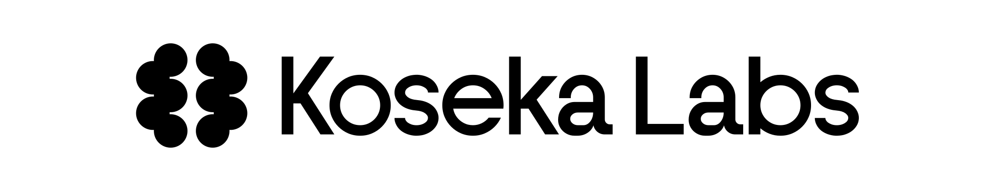
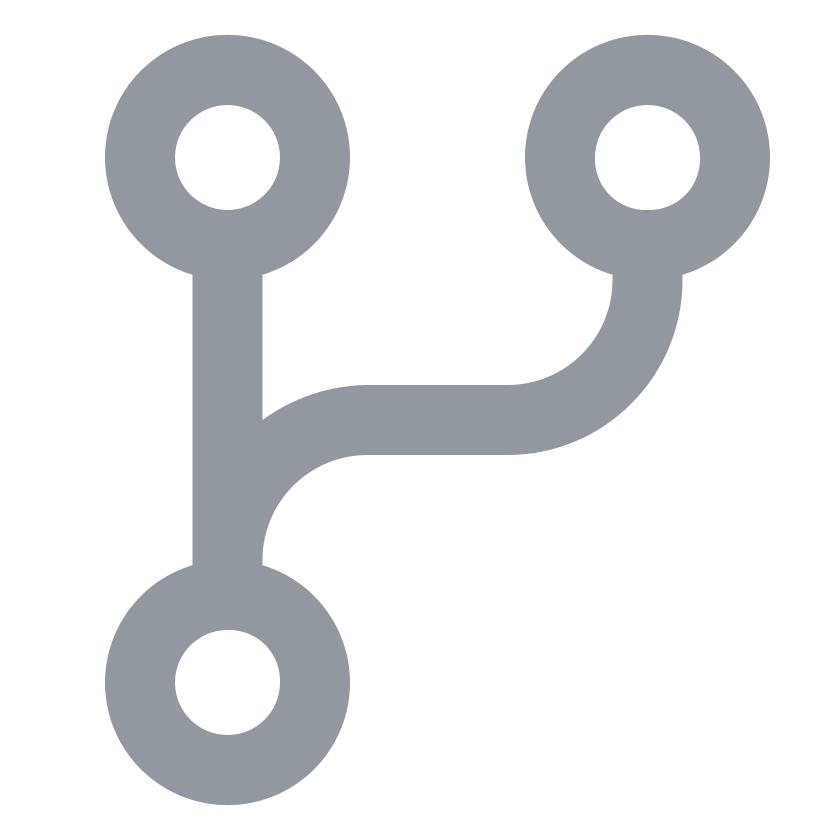
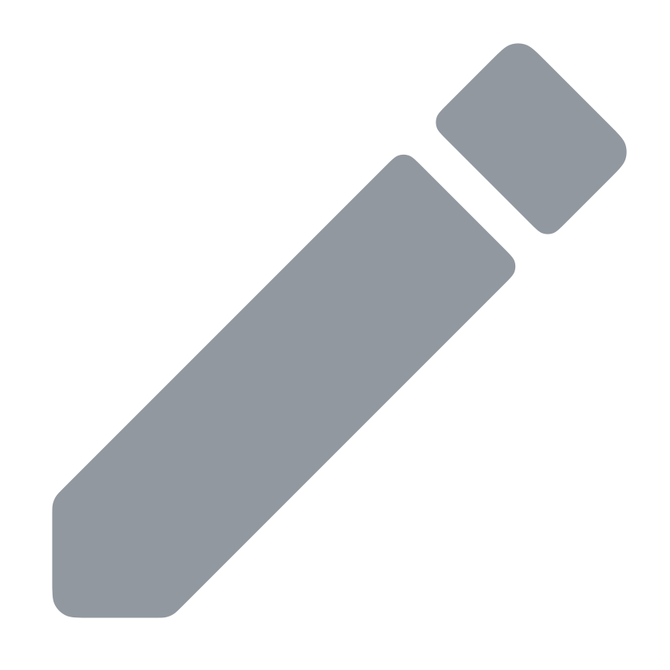

  
  

    Contributions, corrections, and requests can be made through GitHub, and the design documentation lives in the <a href="docs">docs</a> directory.
  

  
Thank you for your interest in the project, enjoy your reading! 🚀

  
  
   
  
  
  

---

QualiaOS is an open source, agentic mobile operating system. It is built on [Kalium](https://github.com/KosekaLabs/kalium), a Rust kernel that runs only WebAssembly, and it ships with a built-in, open-weights AI model that runs on the phone's NPU and acts on the user's behalf.

The idea in three sentences:

1. **The browser replaces the operating system.** Every app is a web app, with or without extra permissions granted by the user. There are no native apps, plugins or extensions.
2. **The kernel only runs WebAssembly.** JavaScript, HTML and CSS are not special: their interpreters and engines are themselves WebAssembly modules that ship with the OS, and web content is just assets those modules load. Any language that compiles to WebAssembly, or whose interpreter does, is a first-class citizen.
3. **Humans stop navigating the web; the agent does it for them.** The interface is audio-centric. The user talks to the phone, the model talks back through articulatory speech synthesis, and it generates on-screen widgets only when audio is the worse way to convey something.

<h2>&nbsp;&nbsp;Branches</h2>

| Branch | Description                                                                               |
| :----- | :---------------------------------------------------------------------------------------- |
| `dev`  | The development branch. A first stable branch, `v1`, will be cut from it once code lands. |

**Note for Contributors:** Please submit all feature requests and standard bug fixes to the **`dev`** branch.

## Status

QualiaOS itself is in its design phase: there is nothing to install yet. The documents below are the reference for what is intended and are expected to change as the decisions in [docs/open-questions.md](docs/open-questions.md) get resolved.

The documents were written without some of the decisions recorded in Koseka's internal notes on QualiaOS, chiefly the later shape of the model and of the interface (voice, widgets and text, with websites driven by the agent in the background). Where they differ, the recorded decisions win; the differences are listed at the end of [docs/open-questions.md](docs/open-questions.md) until each document is brought in line.

The kernel is further along: the first [Kalium](https://github.com/KosekaLabs/kalium) prototype boots on QEMU (aarch64), runs WebAssembly services through a spec-tested interpreter, and demonstrates capability-gated host calls, IPC with capability transfer, and real-time plus fair scheduling. Its `docs/status.md` covers what runs, how it was verified, the open decisions (the kernel's base first) and the next steps.

## Documentation

| Document | What it covers |
| --- | --- |
| [docs/system-architecture.md](docs/system-architecture.md) | The layers of the OS, from Kalium to web apps, and how the agent fits in. |
| [docs/web-apps-and-permissions.md](docs/web-apps-and-permissions.md) | How web apps become "apps", the capability and permission model, and the shared runtime shelf of pre-compiled interpreters. |
| [docs/model-architecture.md](docs/model-architecture.md) | The built-in model: encoder, cognitive chain, decoder, the inference cycle and the sliding context window. |
| [docs/agent-interface.md](docs/agent-interface.md) | What the model perceives and what it can do: foveated vision, live audio, articulatory speech, widgets and phone actions. |
| [docs/open-questions.md](docs/open-questions.md) | Dimension checks, budgets, and the design decisions that still need to be made. |

The kernel has its own documentation in the [Kalium repository](https://github.com/KosekaLabs/kalium).

<h2>&nbsp;&nbsp;Security</h2>

Vulnerabilities and sensitive information should not be reported via public GitHub issues. Please refer to the [Security Policy](SECURITY.md) for details on supported versions and instructions on how to responsibly disclose security concerns.

<h2>&nbsp;&nbsp;Contributing</h2>

This project is open to contributions and suggestions, and any help or feedback is highly appreciated. There is no code of conduct, but please be respectful and considerate when engaging with the community.

This project follows [Phased Versioning](https://labs.koseka.net/phased-versioning) for its versioning, branching, and release rules, and [Conventional Commits](https://www.conventionalcommits.org/en/v1.0.0/) for its commit messages. So, make sure to read both first before contributing to the project in any way. Additionally, please refer to the [Contribution Guide](CONTRIBUTING.md) for setup instructions and guidance on how to contribute the project.

Unless you explicitly state otherwise, any contribution intentionally submitted for inclusion in this project by you, shall be licensed as below, without any additional terms or conditions.

<h2>&nbsp;&nbsp;License</h2>

Copyright 2026 Amon Rayfa.

This project is licensed under the [Apache License (Version 2.0)](LICENSE). The Koseka and Koseka Labs names, the mark and the banner are brand assets of Koseka and are not covered by it — see the [NOTICE](NOTICE).
